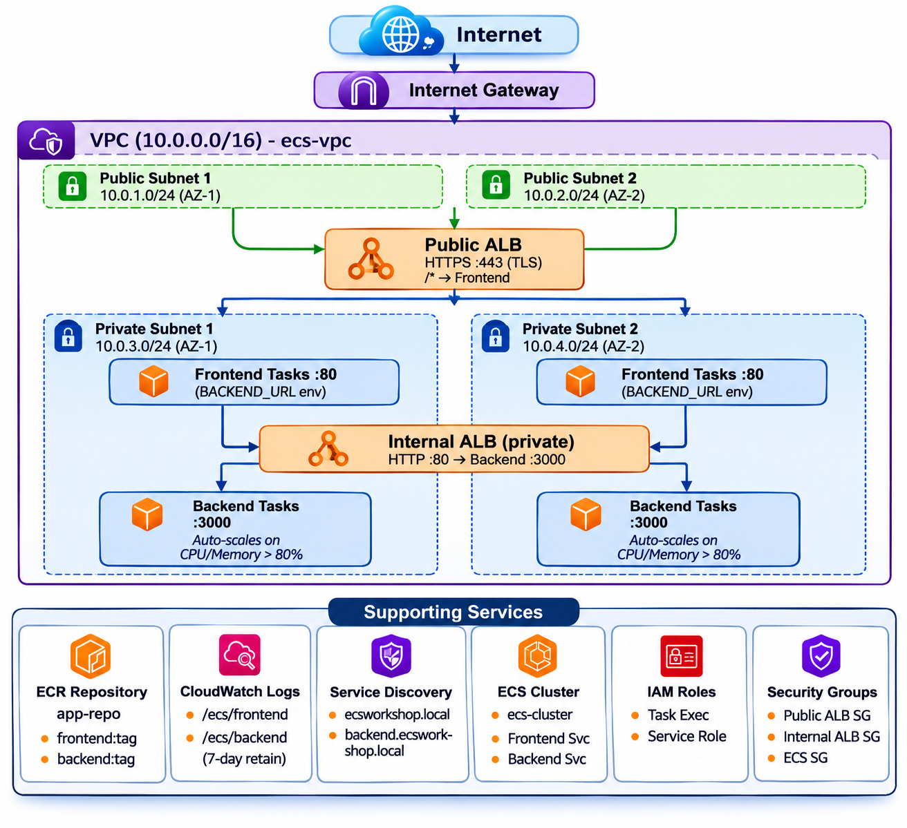

# ECS Workshop Infrastructure

AWS infrastructure for deploying a 2-tier microservice application using Amazon ECS with Fargate, managed entirely with Terraform and deployed via GitHub Actions OIDC.

## Architecture Overview



┌──────────────────────────────────────────────────────────────────────────────┐
│                           Supporting Services                                │
│                                                                              │
│  ┌─────────────────┐  ┌─────────────────┐  ┌──────────────────┐            │
│  │ ECR Repository  │  │ CloudWatch Logs │  │ Service Discovery │            │
│  │ app-repo        │  │ /ecs/frontend   │  │ ecsworkshop.local │            │
│  │ - frontend:tag  │  │ /ecs/backend    │  │ backend.ecswork-  │            │
│  │ - backend:tag   │  │ (7-day retain)  │  │ shop.local        │            │
│  └─────────────────┘  └─────────────────┘  └──────────────────┘            │
│                                                                              │
│  ┌─────────────────┐  ┌─────────────────┐  ┌──────────────────┐            │
│  │ ECS Cluster     │  │ IAM Roles       │  │ Security Groups   │            │
│  │ ecs-cluster     │  │ - Task Exec     │  │ - Public ALB SG   │            │
│  │ - Frontend Svc  │  │ - Service Role  │  │ - Internal ALB SG │            │
│  │ - Backend Svc   │  │                 │  │ - ECS SG          │            │
│  └─────────────────┘  └─────────────────┘  └──────────────────┘            │
└──────────────────────────────────────────────────────────────────────────────┘
```

## Project Structure

```
ecsworkshop-infra/
├── bootstrap/                      # One-time setup (run manually)
│   ├── main.tf                     #   S3 state bucket, GitHub OIDC, IAM role
│   ├── providers.tf                #   Terraform & AWS provider (local state)
│   ├── variables.tf                #   GitHub org/repo, region, bucket name
│   ├── locals.tf                   #   Computed values
│   └── outputs.tf                  #   Role ARN and bucket name
│
├── network-stack/                  # Network stack (root module)
│   ├── main.tf                     #   Calls modules/networking
│   ├── providers.tf                #   Terraform & AWS provider with S3 backend
│   ├── backend.hcl                 #   S3 backend config (network/terraform.tfstate)
│   ├── variables.tf                #   VPC CIDR
│   ├── locals.tf                   #   Subnets, AZs, common tags
│   ├── data.tf                     #   Availability zones data source
│   └── outputs.tf                  #   VPC and subnet IDs
│
├── ecs-stack/                      # ECS stack (root module)
│   ├── main.tf                     #   Calls modules/ecs
│   ├── providers.tf                #   Terraform & AWS provider with S3 backend
│   ├── backend.hcl                 #   S3 backend config (ecs/terraform.tfstate)
│   ├── variables.tf                #   ACM certificate ARN
│   ├── locals.tf                   #   Common tags
│   ├── data.tf                     #   Reads network stack remote state
│   └── outputs.tf                  #   ALB DNS, ECR URL, cluster name
│
├── modules/
│   ├── networking/                 # Child module — VPC, subnets, IGW, route tables
│   │   ├── main.tf
│   │   ├── variables.tf
│   │   └── outputs.tf
│   └── ecs/                        # Child module — ECS cluster, ALB, services, auto-scaling
│       ├── main.tf
│       ├── variables.tf
│       └── outputs.tf
│
├── templates/                      # Original CloudFormation templates (reference only)
│   ├── network-stack.cf.yml
│   └── ecs-stack.cf.yml
│
├── .github/workflows/
│   └── deploy.yml                  # CI/CD — deploys infrastructure/ on push to main
│
├── .gitignore
└── README.md
```

## Infrastructure Components

### 1. Bootstrap

Creates the foundational resources needed before any CI pipeline can run:

- **S3 Bucket** (`ecs-workshop-tfstate`): Stores Terraform remote state for all stacks, encrypted with KMS, public access blocked
- **GitHub OIDC Provider**: Registers GitHub Actions as an identity provider so workflows authenticate without long-lived credentials
- **IAM Role** (`github-actions-ecs-workshop`): Assumed by GitHub Actions via OIDC, with permissions for S3 state access and EC2 networking

### 2. Network Stack (`network-stack/`)

Provisions the VPC and networking layer using `modules/networking`:

- **VPC** (10.0.0.0/16) with DNS support enabled
- **Public Subnets**: 2 subnets across AZs (10.0.1.0/24, 10.0.2.0/24) — hosts the ALB
- **Private Subnets**: 2 subnets across AZs (10.0.3.0/24, 10.0.4.0/24) — hosts ECS tasks
- **Internet Gateway**: Enables internet access for public subnets
- **Route Tables**: Public routes through IGW, private subnets with local-only routing

### 3. ECS Stack (`ecs-stack/`)

Provisions the application layer using `modules/ecs`:

- **ECR Repository** (`app-repo`): Stores Docker images with vulnerability scanning on push
- **ECS Cluster** (`ecs-cluster`): Manages Fargate services
- **Public ALB**: Internet-facing, HTTPS-only (port 443) with TLS termination via ACM wildcard certificate (`*.chakra86.store`) — all traffic goes to the frontend
- **Internal ALB**: Private, HTTP (port 80) — sits between frontend and backend in private subnets so the backend is never directly exposed to the internet
- **ECS Services**: Frontend (port 80) and backend (port 3000) on Fargate in private subnets. Frontend reaches the backend via the internal ALB (`BACKEND_URL` environment variable)
- **Auto-Scaling**: Target-tracking policies scale tasks when average CPU or memory exceeds 80% (configurable min/max capacity)
- **Service Discovery**: Private DNS namespace (`ecsworkshop.local`) — backend also reachable at `backend.ecsworkshop.local`
- **CloudWatch Log Groups**: `/ecs/frontend` and `/ecs/backend` with 7-day retention
- **IAM Roles**: Task execution role (ECR pull + CloudWatch logs) and service role
- **Security Groups**: ALB allows HTTPS from internet; ECS tasks accept traffic only from ALB

## Key Features

- **HTTPS Only**: Public ALB terminates TLS on port 443 with a wildcard ACM certificate — no plaintext HTTP listener exposed to the internet
- **Two-tier ALB**: Public ALB serves the frontend; a private internal ALB routes frontend-to-backend traffic so the backend is never directly reachable from the internet
- **Auto-Scaling**: Services scale out/in based on CPU and memory utilization (80% threshold)
- **High Availability**: Multi-AZ deployment across 2 availability zones
- **Security**: Private subnets for workloads, dedicated security groups per tier (public ALB, internal ALB, ECS tasks), least-privilege IAM roles
- **Service Discovery**: Internal DNS via Cloud Map for service-to-service communication
- **Remote State**: All stacks store state in S3 with KMS encryption and locking
- **CI/CD**: GitHub Actions with OIDC — no long-lived AWS credentials

## Deployment

Deployments follow a strict sequence: **bootstrap** → **network stack** → **ECS stack**. Each step depends on the previous one.

### Prerequisites

- AWS CLI configured with appropriate permissions
- Terraform >= 1.10
- A validated ACM certificate in us-east-1 for the ALB domain

### Step 1: Bootstrap (one-time, manual)

Creates the S3 state bucket and GitHub Actions IAM role. Uses local state since the S3 bucket doesn't exist yet.

```bash
cd bootstrap

terraform init
terraform apply \
  -var="github_org=YOUR_GITHUB_ORG" \
  -var="github_repo=YOUR_REPO_NAME"
```

After apply, copy the `github_actions_role_arn` output and configure it in GitHub:

1. Go to your repo **Settings > Secrets and variables > Actions > Variables**
2. Create a variable named `AWS_ROLE_ARN` with the role ARN value

### Step 2: Deploy Network + ECS Stacks

Both stacks deploy automatically via GitHub Actions on every push to `main`. The pipeline runs the network stack first, then the ECS stack (see [CI/CD Pipeline](#cicd-pipeline) below).

To deploy manually instead:

**Network Stack** — provisions the VPC, subnets, internet gateway, and route tables:

```bash
cd network-stack

terraform init -backend-config=backend.hcl
terraform plan -out=tfplan
terraform apply tfplan
```

**ECS Stack** — provisions the ECS cluster, ALBs, services, and supporting resources. Reads network stack outputs from remote state:

```bash
cd ecs-stack

terraform init -backend-config=backend.hcl
terraform plan -var-file=ecs-stack.tfvars -out=tfplan
terraform apply tfplan
```

### Step 4: Deploy Application Containers

After the infrastructure is up, push Docker images to ECR and update the ECS service desired count:

1. Authenticate Docker to ECR
2. Build and push `frontend-latest` and `backend-latest` tags to the `app-repo` repository
3. Update the desired count on the ECS services to start tasks

For the full application deployment workflow, see the companion repository:
**[ECS Workshop Application Repository](https://github.com/himanshurgit/ecsworkshop-app.git)**

## Outputs

### Network Stack
| Output | Description |
|--------|-------------|
| `vpc_id` | ID of the VPC |
| `public_subnet_ids` | Map of public subnet names to IDs |
| `private_subnet_ids` | Map of private subnet names to IDs |

### ECS Stack
| Output | Description |
|--------|-------------|
| `alb_dns_name` | DNS name of the public ALB (point your domain here) |
| `internal_alb_dns_name` | DNS name of the internal ALB (frontend → backend) |
| `ecr_repository_url` | ECR repository URL for pushing images |
| `cluster_name` | Name of the ECS cluster |

## CI/CD Pipeline

The GitHub Actions workflow (`.github/workflows/deploy.yml`) runs automatically on every push to `main` and deploys both stacks in sequence:

| Job | Working Directory | What it does |
|-----|------------------|--------------|
| `deploy-network` | `network-stack/` | `terraform init` → `plan` → `apply` for the VPC and networking layer |
| `deploy-ecs` | `ecs-stack/` | Waits for network to finish, then `terraform init` → `plan -var-file=ecs-stack.tfvars` → `apply` for the ECS application layer |

Both jobs:
1. Check out the code
2. Assume the IAM role via OIDC (no long-lived credentials)
3. Run Terraform init, plan, and apply

The `deploy-ecs` job has `needs: deploy-network`, so it only runs after the network stack succeeds.

## Cost Optimization

- **Fargate**: Pay only for running containers (no EC2 instances to manage)
- **Auto-Scaling**: Scale to zero when idle, scale up only under load
- **Log Retention**: 7-day retention to minimize CloudWatch storage costs
- **Resource Sizing**: Minimal Fargate allocation (0.25 vCPU, 512 MB memory per task)

## Troubleshooting

| Problem | Check |
|---------|-------|
| `terraform init` fails | Verify the S3 state bucket exists (`ecs-workshop-tfstate`) and `backend.hcl` values are correct |
| GitHub Actions fails | Confirm `AWS_ROLE_ARN` variable is set and the OIDC trust policy matches your repo and branch |
| ECS stack fails to plan | Ensure the network stack has been applied first — the ECS stack reads its remote state |
| Tasks not starting | Check that Docker images exist in ECR with the expected tags (`frontend-latest`, `backend-latest`) |
| Public ALB returns 502 | Verify public ALB SG allows HTTPS 443, ECS SG allows port 80 from public ALB SG, and frontend health check `/` returns 200 |
| Backend unreachable | Verify internal ALB SG allows port 80 from ECS SG, ECS SG allows port 3000 from internal ALB SG, and backend health check `/api/health` returns 200 |
| HTTPS not working | Confirm the ACM certificate is validated and in us-east-1 |
